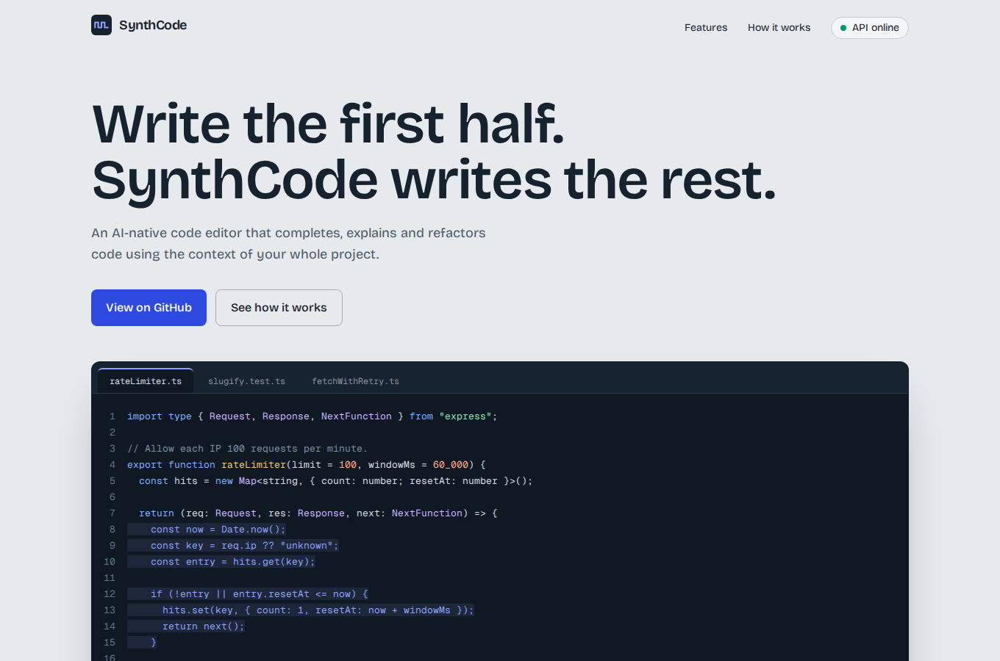

# SynthCode

**A code editor with the power of AI.**

SynthCode is an AI-native code editor project: inline completions, questions
about your codebase, and prompt-based edits. This repository is the first
milestone: the project skeleton, a health-checked API, and a landing page with a
scripted editor demo.



## Status

| Part | State |
|---|---|
| Backend (`GET /api/health`) | Working, tested |
| Frontend landing page with a live API status indicator | Working |
| AI service (`GET /health`) | Working, tested |
| Editor, completions, chat, indexing | Planned, see [the roadmap](docs/architecture.md#roadmap) |

The editor on the landing page is a scripted demo with canned suggestions. No
model is connected yet.

## Quick start

You need Node.js 20 or newer. Python 3.11 or newer is only needed for the AI service.

```bash
# 1. Backend: http://localhost:4000
cd backend
npm install
cp .env.example .env
npm run dev

# 2. Frontend: http://localhost:5173 (in a second terminal)
cd frontend
npm install
npm run dev
```

Open http://localhost:5173. The pill in the top right reads **API online** once
the backend is reachable. In development Vite proxies `/api` to the backend, so
no CORS setup is needed.

To run all three services in containers:

```bash
docker compose up --build
# frontend http://localhost:8080 · backend http://localhost:4000/api/health · ai http://localhost:8000/health
```

## API

### `GET /api/health`

```json
{
  "status": "ok",
  "service": "synthcode-backend",
  "version": "0.1.0",
  "environment": "development",
  "uptimeSeconds": 42,
  "timestamp": "2026-11-04T16:48:06.946Z"
}
```

Unknown routes return `404` with a JSON body: `{ "error": "NotFound", "message": "..." }`.

## Project structure

```
SynthCode/
├── backend/            TypeScript API (Express 5, routing-controllers, InversifyJS)
│   └── src/
│       ├── bootstrap/  module loader
│       ├── config/     environment-driven settings
│       ├── modules/    one folder per feature (controllers, services, tests)
│       │   └── health/
│       ├── shared/     middleware used by every module
│       ├── app.ts      builds the Express app (importable by tests)
│       └── index.ts    starts the server
├── frontend/           React 19, Vite, TanStack Router and Query, Tailwind CSS 4
│   └── src/
│       ├── routes/     file-based routes
│       ├── features/   landing page and the editor demo
│       ├── components/ shared UI
│       ├── hooks/      data hooks (React Query)
│       └── services/   API client
├── ai/                 Python FastAPI service (health check for now)
├── docs/               architecture notes and roadmap
├── .github/workflows/  CI for all three services
└── docker-compose.yml
```

How the backend discovers and wires modules is described in
[docs/architecture.md](docs/architecture.md).

## Scripts

| Where | Command | What it does |
|---|---|---|
| `backend/` | `npm run dev` | Start with auto-reload |
| `backend/` | `npm run build` / `npm start` | Compile to `build/` and run it |
| `backend/` | `npm run typecheck` | Type-check without emitting |
| `backend/` | `npm test` | Run Vitest (unit and HTTP tests) |
| `frontend/` | `npm run dev` | Start the dev server |
| `frontend/` | `npm run build` | Production build, then type-check |
| `frontend/` | `npm test` | Run Vitest |
| `ai/` | `pytest` | Run the Python tests |

## Configuration

`backend/.env`

| Variable | Default | Purpose |
|---|---|---|
| `PORT` | `4000` | Port to listen on |
| `ROUTE_PREFIX` | `/api` | Prefix for every route |
| `CORS_ORIGINS` | `http://localhost:5173` | Comma-separated allowed origins |
| `APP_MODULE` | `all` | Load every module, or just the named one |
| `DB_URL` | none | MongoDB connection string. The server connects at start-up and exits with an error if it can't |
| `DB_NAME` | `synth-db` | Database name |
| `SKIP_DB_CONNECTION` | `false` | Set to `true` to start without a database |

`frontend/.env`: `VITE_API_BASE_URL` is empty by default, which means "same origin".

Before publishing, set your repository URL in `frontend/src/config/site.ts`.

## Tech

TypeScript · Node.js · Express 5 · routing-controllers · InversifyJS · Vitest ·
supertest · React 19 · Vite · TanStack Router · TanStack Query · Tailwind CSS 4 ·
Python · FastAPI · Docker · GitHub Actions

## License

MIT
