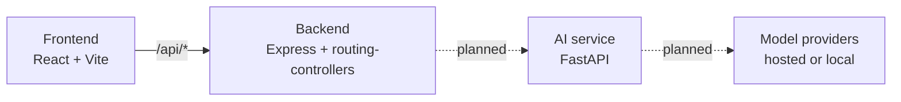

# SynthCode architecture

## Overview



Solid arrows exist today. Dotted arrows are planned.

## Services

| Folder | Stack | Status |
|---|---|---|
| `frontend/` | React 19, Vite, TanStack Router and Query, Tailwind CSS 4 | Landing page with a scripted editor demo and a live API status indicator |
| `backend/` | TypeScript, Express 5, routing-controllers, InversifyJS | `GET /api/health` |
| `ai/` | Python, FastAPI | `GET /health` |

## Backend structure

The backend is organised into feature modules under `backend/src/modules`.
`bootstrap/loadModules.ts` scans that folder at start-up. Each module's
`index.ts` exports three things the loader looks for, named after the folder:

- `<name>ModuleControllers`: controller classes to register
- `<name>ModuleValidators`: validator classes (reserved for later)
- `<name>ContainerModules`: InversifyJS container modules with the bindings

A module follows this layout:

```
modules/health/
  controllers/   HTTP layer (routing-controllers decorators)
  services/      business logic
  interfaces/    shared types
  tests/         Vitest tests
  container.ts   DI bindings
  types.ts       DI tokens
  index.ts       what the loader reads
```

To add a feature, create a new folder in `modules/` that follows the same layout.
Setting `APP_MODULE=<name>` runs the API with just that module loaded.

`createApp()` in `src/app.ts` builds the Express app without listening on a port,
so tests can import it with supertest.

## Roadmap

1. Editor surface in the frontend (Monaco) with open, edit and save for local files
2. `/api/completions` that streams inline suggestions from a configurable model provider
3. Project indexing: chunk files, embed them, retrieve the relevant chunks for each request
4. Chat over the codebase with answers that cite the files they used
5. Prompt-based edits: select code, describe the change, review a diff
